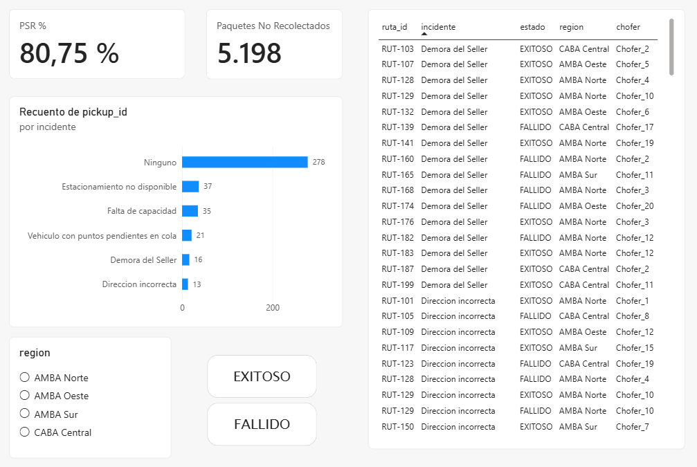

# Control Tower de Logística de Colecta

Dashboard operativo en Power BI para monitorear la **colecta de paquetes** (pickups) de una operación logística: qué porcentaje de las colectas sale bien, cuántos paquetes quedan sin recolectar y por qué fallan.

> Proyecto personal que nace de mi experiencia en operaciones y logística (seguimiento de pedidos, control de pendientes y resolución de reclamos) y de lo que estudio en la Tecnicatura en Programación de la UTN.



## Qué muestra el dashboard

- **PSR % (Pick-up Success Rate):** porcentaje de pickups exitosos sobre el total.
- **Paquetes no recolectados:** diferencia entre los paquetes planeados y los efectivamente recolectados.
- **Pickups por incidente:** cuántas colectas tuvieron cada tipo de problema.
- **Filtros** por región y por estado del pickup (exitoso o fallido).
- **Detalle** de cada pickup: ruta, incidente, estado, región y chofer.

## Datos

Los datos son **sintéticos**: se generan con el script `dataScript.py` (Python + pandas), escrito con asistencia de IA. No se usan datos reales de ninguna empresa.

El modelo es una estrella simple con dos tablas:

| Tabla | Tipo | Columnas |
|---|---|---|
| `dim_rutas` | Dimensión | `ruta_id`, `region`, `chofer`, `capacidad_camion_paquetes`, `fecha` |
| `fact_pickups` | Hechos | `pickup_id`, `ruta_id`, `seller_id`, `paquetes_planeados`, `paquetes_recolectados`, `estado`, `incidente`, `hora_llegada` |

Se relacionan por `ruta_id` (una ruta tiene muchos pickups). La simulación genera 100 rutas y 400 pickups con `random.seed(42)`, así que los resultados son reproducibles.

## Resultados del análisis

Sobre los datos generados, el PSR global es **80,75 %** y quedan **5.198 de 35.035 paquetes** sin recolectar (14,8 %).

| Incidente | Pickups | PSR | % de los paquetes no recolectados |
|---|---|---|---|
| Ninguno | 278 | 100 % | 0 % |
| Demora del Seller | 16 | 62,5 % | 5,2 % |
| Dirección incorrecta | 13 | 46,2 % | 8,9 % |
| Vehículo con puntos pendientes en cola | 21 | 52,4 % | 17,7 % |
| Falta de capacidad | 35 | 34,3 % | 26,1 % |
| Estacionamiento no disponible | 37 | 16,2 % | 42,1 % |

- **Estacionamiento no disponible** es la mayor causa de pérdida: casi el 42 % de los paquetes no recolectados, y solo el 16 % de esos pickups sale bien.
- **Falta de capacidad** es la segunda: sumada a la anterior explica cerca del 68 % de lo no recolectado.
- Por región, el PSR más bajo es el de **CABA Central (76,7 %)** y el más alto el de **AMBA Oeste (83,8 %)**.

Los porcentajes se calcularon sobre los CSV generados por el script.

## Cómo reproducirlo

Requiere Python 3 y pandas.

```bash
pip install pandas
python dataScript.py
```

El script crea `dim_rutas.csv` y `fact_pickups.csv`. Después, en Power BI Desktop, abrí `Control_Tower.pbix` o importá los CSV y creá la relación por `ruta_id`.

## Estructura del repositorio

```
├── README.md
├── dataScript.py
├── dim_rutas.csv
├── fact_pickups.csv
├── Control_Tower.pbix
└── capturas/
    └── dashboard.png
```

## Próximos pasos

- Gráfico de PSR por incidente y por región para mostrar la causa raíz directamente en el dashboard.
- Cargar los datos en MySQL y calcular los KPIs con consultas SQL.
- Hacer que la capacidad del camión influya en los incidentes de "Falta de capacidad".

## Tecnologías

- Python (pandas)
- Power BI
- Power Query
- Google Sheets
